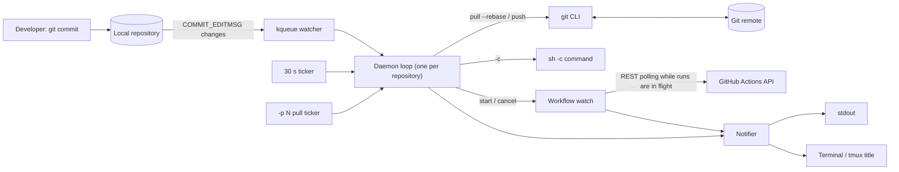
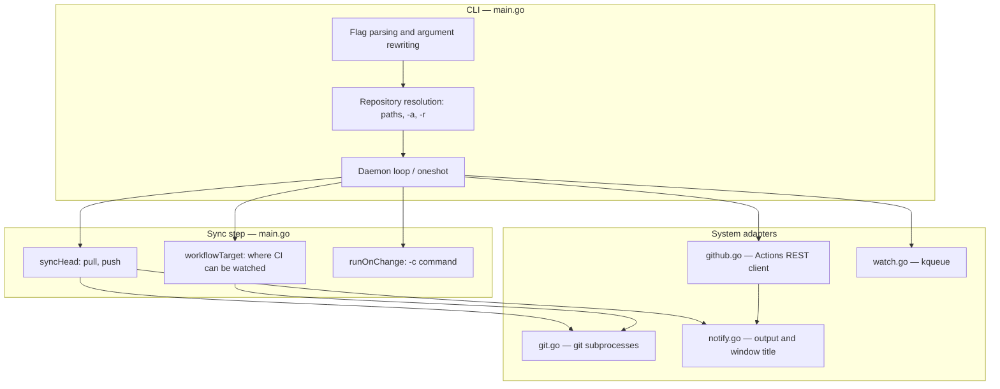

# Architecture

## High-level architecture

Oneshot mode (`-1`) runs the same sync step once per repository, waits for the
workflow watch in the foreground and exits with its result.

## Block diagram

There is no database.
