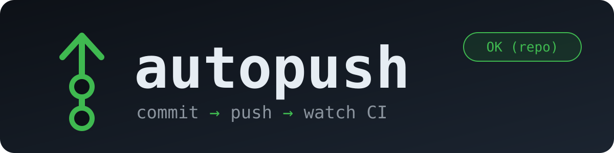

<p align="center"></p>

autopush pushes your commits as soon as you make them and follows the GitHub
Actions runs they trigger. It is for people who commit often and want CI
results in the terminal instead of a browser tab.

## Features

- **Push on commit**: every new commit is pushed right away.
- **CI watch**: follows the workflow runs for the pushed commit and reports
  success, or each failed run with a link.
- **Idle when settled**: GitHub is only queried while a run is in progress.
- **Pull first**: `-p` rebases onto the remote before each push, `-p N` also
  every N seconds.
- **Run a command**: `-c` runs a shell command after commits were pulled or
  pushed, for example a rebuild.
- **Many repositories**: several paths, every repository in a directory, or
  submodules.
- **Status at a glance**: colored output and `OK` / `FAIL` in the terminal or
  tmux window title.

## Usage

```sh
cd ~/src/project && autopush        # watch the current repository
autopush ~/src/a ~/src/b            # watch several
autopush -1                         # push once, wait for CI, exit with its result
autopush -p 60 -c "make && make install" ~/src/tool
```

```
(project) [14:02:11] watching [main]
(project) [14:05:40] pushed 3f9c1a2e
(project) [14:05:41] watching 2 workflow(s)...
(project) [14:07:02] CI passed
```

## Options

| Flag | Effect |
|---|---|
| `-1` | Push once, wait for CI, exit with its result |
| `-p` | `git pull --rebase` before each push |
| `-p N` | Same, and also pull every N seconds |
| `-c "cmd"` | Run `cmd` with `sh` in the repository root after a pull or push brought changes |
| `-a` | Watch every usable repository in the current directory |
| `-r` | Also watch submodules |

Short flags combine: `-arp60` means `-a -r -p 60`. `-c` must stand alone.

`-a` and `-r` only pick up repositories that are on a branch with a fetched
upstream and an ssh remote. Others are skipped with a warning.

## GitHub token

Watching CI needs a token that can read the repository's Actions runs.
autopush uses the first one it finds:

| Source | Where |
|---|---|
| `GITHUB_TOKEN` | environment |
| `GH_TOKEN` | environment |
| `.gh_token` | repository root |
| `.gh_token` | home directory |

Without a token, commits are still pushed; only the CI watch is skipped.

## Exit codes with `-1`

| Code | Meaning |
|---|---|
| `0` | Pushed; CI passed or no workflow ran |
| `1` | Pull, push or GitHub request failed |
| `2` | CI failed |

With several repositories, the worst result wins.

## tmux

autopush sets the window name to `OK (repo)` or `FAIL (repo)`. tmux only
accepts it with `set -g allow-rename on`; automatic renaming is switched back
on when autopush exits. The pane title carries the same text and can be shown
with `#T` in the status line.
